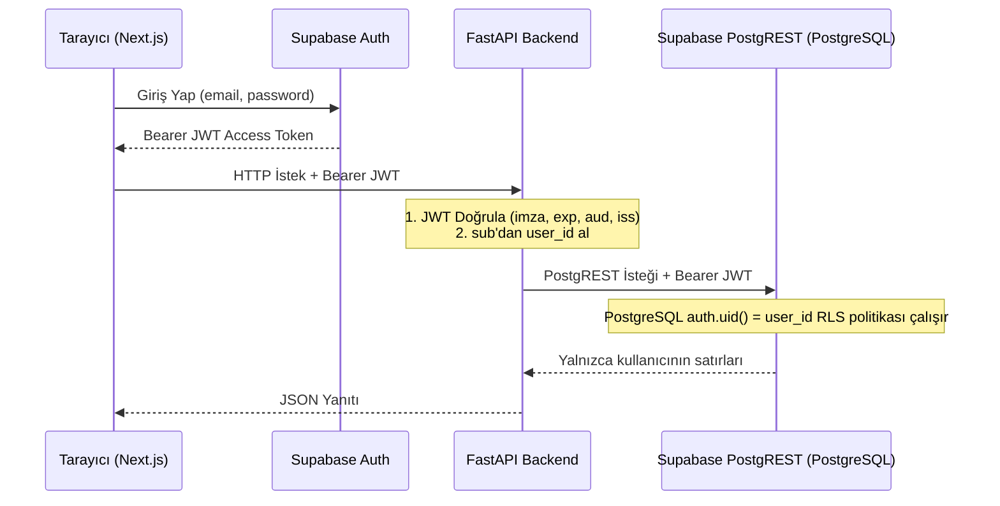

# Benim Payım — Teknik Mimari Dokümantasyonu

Bu doküman, “Benim Payım” uygulamasının katmanlarını, güvenlik politikalarını ve veri erişim kurallarını detaylandırır.

## 1. Veri Erişim Katmanı (No-ORM Prensibi)

Uygulamada SQLAlchemy, Prisma veya benzeri bir ORM kullanılmamıştır.
Bunun temel sebebi Supabase PostgreSQL'in sunduğu **Row Level Security (RLS)** mekanizmasını saf haliyle çalıştırmaktır.

- **Frontend:** Yalnızca kimlik doğrulama için Supabase Auth istemcisini kullanır. İş verilerini doğrudan Supabase'e yazmaz; tüm istekler FastAPI üzerinden akar.
- **FastAPI:** Doğrulanmış kullanıcı JWT'sini Supabase PostgREST Data API'sine `Authorization: Bearer <user_jwt>` başlığıyla iletir.
- **Service-Role:** Kullanıcı isteklerinde hiçbir zaman service-role anahtarı kullanılmaz; böylece RLS asla atlanamaz.

---

## 2. PostgreSQL RLS Politikaları

6 tablonun tamamında RLS etkindir:
1. `learning_sessions`: `auth.uid() = user_id`
2. `session_entries`: `auth.uid() = user_id` VE `EXISTS (SELECT 1 FROM learning_sessions WHERE id = session_id AND user_id = auth.uid())`
3. `help_requests`: `auth.uid() = user_id` VE oturum sahipliği
4. `learning_checks`: `auth.uid() = user_id` VE `UNIQUE (session_id)`
5. `check_attempts`: `auth.uid() = user_id` VE kontrol & oturum sahipliği
6. `learning_cards`: `auth.uid() = user_id` VE `UNIQUE (session_id)`

---

## 3. Güvenlik ve Gizlilik Prensipleri

1. **Prompt Injection Savunması:** Kullanıcı kodu ve notları AI'ya gönderilirken metinsel veri bloğu olarak paketlenir ve sistem promptunu ezmesi engellenir.
2. **Idempotency-Key:** Çift tıklamalar `Idempotency-Key` başlığı ve önbellek ile karşılanır; mükerrer AI çağrısı yapılmaz.
3. **Kullanıcı Başına Hız Sınırı:** Dakikada en fazla 30 AI isteği sınırı ile kaynak tükenmesi önlenir.
4. **Log Gizliliği:** Loglara şifreler, token'lar, kaynak kodlar veya kullanıcı konuşmaları yazılmaz.
